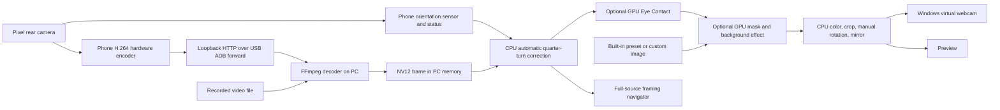

# PixelCam 0.7.0 — user manual and programmer's guide

PixelCam turns a Pixel's rear camera into a Windows webcam, with PC controls for lens, resolution, color, framing, NVIDIA Maxine background effects, and optional NVIDIA Eye Contact. It also accepts recorded video, so you can learn and test without connecting a phone.

**Current milestone:** Version 0.7.0 adds a Windows installer with a bundled .NET 10 runtime and extraction helper, GPU detection, and matching Maxine downloads for Turing, Ampere, Ada and Blackwell. Video/USB tools download during installation; the Background tab downloads the larger AI packages on request and reuses them afterward. Actual GPU inference has been tested on the RTX 3080; other families have package and selection validation only. The Android sender remains **0.2.0**. Earlier version-specific results below are historical.

## 1. Try it without a phone

1. Leave the phone disconnected. Open **PixelCam** from the Windows Start menu or run `PixelCam.exe` in this folder. Normal startup waits for you to choose a source; it does not automatically connect to the phone.
2. Open the **gear icon → Open video…** and choose `samples/input_0_100_frames.mp4`. It loops automatically. Lens and resolution selectors are disabled for a file because those are properties of the recording.
3. Open the **Background** tab. If shown, click **Set up Maxine** once and follow its progress. When ready, select **Blur background** and move the strength slider. Try **Replace background**, then a built-in option such as **Pure black** or **Soft neutral gradient**. For your own picture, select **Custom image…**, then **Choose image…**.
4. Optionally check **Eye contact** beside the orientation controls. If its runtime is missing, use **Set up Eye contact** in the Background tab. Open **Color & framing** to adjust the image. Saved values and Auto choices return on launch; a fresh setup starts with manual neutral values. Double-click a slider's handle to reset it. Changes affect both preview and webcam output.
5. Leave **Webcam output** checked. In your video application's camera menu, select **PixelCam**. Stop any OBS virtual-camera publisher first. The OBS desktop application is not required.

For a shortcut to the supplied clip with blur enabled, open PowerShell in this folder and run:

```powershell
.\Try-Sample.ps1
```

Use one PixelCam instance at a time. Close it when finished. The program does not record the live phone camera to disk during normal use. Recorded test commands described below deliberately write diagnostic images from their supplied video file.

The two supplied clips are adjacent 100-frame excerpts of the same seated speaker, each 1920 × 1080 at 30 fps and about 3.33 seconds long. Their source, license, and checksums are in [samples/SOURCES.md](https://github.com/frkatona/pixelcam/blob/main/samples/SOURCES.md).

## 2. Controls

### Sources, orientation, and output

| Control | What it does |
| --- | --- |
| **Gear icon → Open video…** | Opens a local video file and loops it at its playback rate. Phone-sensor Auto does not simulate orientation for a recording; use a manual Rotate angle when needed. File rotation metadata is not applied automatically. |
| **Connect phone / Reconnect** | Explicitly discovers an authorized USB phone, installs or upgrades the bundled PixelCam sender when needed, opens it, and starts the stream. Click it when you intend to use the phone camera. |
| **Lens** | Chooses the physical rear lens. The Pixel 8 Pro exposes ultra-wide 0.5×, wide 1×, and telephoto 5× in this app. |
| **Resolution** | Chooses the phone capture size: 640 × 480, 1280 × 720, 1920 × 1080, or 3840 × 2160 where supported. |
| **Rotate: Auto** | Default for normal phone use. Keeps the image upright using the phone's physical orientation, including a 180° turn with Android screen rotation locked. A portrait turn swaps output width and height. |
| **Rotate: 0° / 90° / 180° / 270°** | Manual output-orientation override. Choose one to stop following the phone sensor. |
| **Mirror** | Manually flips the final picture horizontally. Auto orientation turns the picture upright; it does not automatically mirror the rear camera. |
| **Eye contact** | Enables NVIDIA gaze redirection for a detected face. Works alone or with a background effect. Off on first use; saved preferences can restore a later choice. |
| **Webcam output** | Publishes the processed video as the Windows camera named PixelCam. The preview continues if this is unchecked. |
| **Gear icon → Appearance** | Chooses Midnight, Graphite, or Light immediately. The choice is saved. |

There is no Apply button. Lens and resolution changes apply after a short debounce and briefly rebuild the phone's camera/encoder stream. Color, crop, zoom, manual rotation, and mirroring update per frame without restarting the decoder. Background and Eye Contact choices also apply live; loading a Maxine model can introduce a short pause. Automatic orientation waits for a stable quarter turn, then changes the processing buffers and resets AI tracking. It keeps the existing decoder running. A receiving video app may need its camera reselected when portrait/landscape output dimensions change.

Hold the phone roughly upright so gravity provides a clear orientation. When it is flat or the orientation is uncertain, Auto retains the last known angle rather than guessing. It corrects 90° steps, not a continuously tilted horizon. The manual angles remain available for an unusual mount or a recording.

### App settings and appearance

The gear icon at the upper right opens the compact app-settings menu. **Open video…** is there to keep the main working area focused on the phone controls. **Appearance** offers **Midnight** (blue-gray dark), **Graphite** (warm neutral dark), and **Light**. Changing the palette does not alter video colors or effects. The selected options tab uses a distinct fill and accent underline; tabs still support keyboard navigation. The small camera icon identifies PixelCam on the taskbar and title bar.

### Color & framing

The navigator shows the full source image with an accent-colored crop rectangle inside it. Zoom ranges from 1× to 5×. Drag the rectangle to pan; clicking elsewhere in the image recenters it. The mouse wheel changes zoom. With the navigator focused, arrow keys pan, Shift+arrow moves farther, and Home resets. **Reset** returns to the entire frame.

The small navigator shows the original source in the chosen orientation. The large preview shows the final background, crop, and color processing. Digital zoom enlarges a crop; it cannot create optical detail. Starting with a higher capture resolution leaves more source pixels to crop.

PixelCam restores the color values and Auto choices you last saved. On a fresh setup, all five options start in **manual** mode at their neutral values. Check an individual **Auto** box when you want that option to adapt. **Reset color** switches all five to manual neutral values.

Double-click directly on a slider's **handle** to return it to its neutral value. This means brightness 0, contrast and saturation 100%, gamma 1.00, and white-balance warmth/tint 0. The same gesture returns blur strength to 50% and zoom to 1×. These are logical defaults, not always the arithmetic midpoint of a slider's range. Clicking the track outside the handle keeps its normal stepping behavior. An Auto-controlled color slider is disabled; uncheck Auto before adjusting or double-clicking its handle.

| Option | Manual range and neutral value | Effect |
| --- | --- | --- |
| Brightness | −100 to +100; neutral 0 | Shifts the image's lightness. |
| Contrast | 25% to 200%; neutral 100% | Changes separation between darker and lighter tones. |
| Saturation | 0% to 200%; neutral 100% | Changes color intensity; 0% removes source chroma, though white-balance offsets can still add a tint. |
| Gamma | 0.50 to 2.00; neutral 1.00 | Adjusts midtones; larger values brighten them in this implementation. |
| White balance | Warmth and tint −100 to +100; neutral 0 | Corrects color casts after capture. It is not a Kelvin setting or a lock of the phone's sensor white balance. |

Auto performs a restrained, smoothed correction of the current cropped scene. The phone still performs its normal camera processing. These automatic controls are statistical heuristics, not face-aware color grading. Because background compositing happens before color analysis, a replacement image can influence Auto. Use manual color settings when you need a fixed look across background changes.

While Auto is enabled, its live readings can move the displayed handle and number. Your previous manual number is retained separately. Turning Auto off restores that manual number; changing a lens, background, or unrelated control does not save the live Auto estimate over it.

### Background

Maxine is part of the PixelCam process. You do not launch NVIDIA Broadcast, a separate Maxine application, or a setup script for normal use. If its files are already present, the tab reports **Ready · effects start automatically**. Your saved effect starts when you connect a phone or open a video. With no video source, PixelCam checks readiness without loading a GPU model.

If files are missing, **Set up Maxine** and **Set up Eye contact** appear here. Setup downloads and verifies the required package, then unpacks it while showing progress. **Cancel setup** stops the work and keeps the existing installation. **Retry effects** retries a failed effect without reopening the video source. If runtime files were added after NVIDIA libraries were already loaded, use the offered **Restart PixelCam** button to activate them cleanly; it preserves settings and resumes the current source. See the setup requirements below.

**Off** is the first-use default. **Blur background** keeps the person clear and uses Maxine's background blur filter; strength ranges from 0% to 100%. **Replace background** composites the person over a built-in background or selected still image. The **Replacement** selector offers:

| Background | Appearance |
| --- | --- |
| Pure black | Uniform black before the later color controls. |
| Soft neutral gradient | A gentle light warm-gray to cool-gray gradient; the default when first choosing Replace without an existing picture. |
| Slate gradient | A restrained dark blue-gray gradient. |
| Warm gray gradient | A warmer beige-gray gradient. |
| Pure white | Uniform white before the later color controls. |
| Custom image… | Uses a PNG, JPEG, or BMP chosen with **Choose image…**. |

Built-in backgrounds are drawn mathematically in memory, so they need no image files. A custom image is scaled to fill the oriented source frame and center-cropped, preserving its aspect ratio. Framing and manual rotation then act on the combined picture. All color controls run after compositing and affect the replacement as well as the person; Auto may therefore change how a preset looks. Use neutral manual color settings if you need the final black or white background to remain at that neutral level.

The **Person mask** selector offers four NVIDIA modes:

| Choice | SDK mode | Intended behavior |
| --- | --- | --- |
| Quality · keep chair | 0 | Highest-quality mode that includes a chair in the foreground. |
| Fast · keep chair | 1 | Faster version with the chair included. |
| Quality · remove chair | 2 | Quality mode that treats the chair as background. |
| Fast · remove chair | 3 | Faster version with the chair removed. |

“Keep” and “remove” describe the model's intended classification, not a guarantee for every chair or scene. Maxine works best with one person facing the camera. Hair, fingers, moving objects, low light, multiple people, full-body shots, and unusual camera angles can expose segmentation errors. No physical green screen is required.

The status reports whether Maxine is active and the most recent processing time. If it fails, PixelCam displays an error and passes through the original background so the stream remains usable. Use **Retry effects**, or change the effect, strength, mask mode, or replacement image, to retry. A restart is needed only when requested after runtime setup, rather than on every launch or effect change.

### Eye contact

The **Eye contact** checkbox is in the main control area beside Mirror. Check it to redirect a detected person's gaze toward the camera. It can be used with Background Off, blur, or replacement. It alters the appearance of the eyes in the video; it does not change where you are actually looking. Uncheck it to stop eye processing without stopping the stream. The first-use default is Off, and your later selection is saved.

Start with one clearly visible, upright face and try small gaze offsets. Blinks, occlusion, unsuitable eye/head angles, and uncertain detection can make the SDK reduce or disengage correction. The status distinguishes a detected face from waiting for a face. A detected face does not mean every frame's eyes were visibly changed. In Auto mode the phone's sensor correction happens before Eye Contact, so the model receives the upright frame. A manual Rotate override still happens later with crop/mirror; turning a sideways source upright at that later stage does not fix what the model saw.

This feature uses NVIDIA's AR runtime files as well as the shared VFX pipeline. Use **Background → Set up Eye contact** if they are missing; no separate AR launcher is needed. An AR failure shows an Eye Contact warning while background processing and webcam output continue. Turning Eye contact Off clears that warning. Setup retries effects automatically when safe, or offers **Restart PixelCam** if already-loaded libraries need refreshing. Eye Contact itself is local GPU processing; the 0.2.0 sender update supplies automatic orientation metadata rather than running AI on the phone.

### Saved settings

Settings are stored in `%LOCALAPPDATA%\PixelCam\settings-v2.json`. They include saved manual color numbers and Auto choices, framing, Auto/manual orientation, webcam enablement, background preset or custom-image choice, Eye Contact enablement, appearance, and the last phone lens/resolution. Live Auto estimates are display readings and do not replace the saved manual numbers. Opening a recorded file preserves the last phone camera preference. The recording itself is chosen again on normal launch unless supplied on the command line.

Saved settings take precedence over first-use defaults. For a fresh setup, close PixelCam and rename the settings file to keep a backup. It will be recreated on the next save. Automated UI tests skip normal preference loading/saving.

## 3. Installation and requirements

Download **PixelCam-0.7.0-Setup.exe** from the project's GitHub Releases page and run it. It checks the GPU, downloads checksum-verified video and USB tools, registers the webcam, and creates a Start menu shortcut. The installer includes its .NET 10 runtime and a private 7-Zip helper. Internet access is needed during installation; Maxine downloads remain optional in **Background**. Uninstall through Windows **Installed apps**. Settings and AI packages are retained for reinstallation. The script-based steps below describe the earlier developer delivery.

GPU detection selects pinned packages for RTX Turing (7.5), Ampere (8.6), Ada (8.9), or Blackwell (12.0). Driver 572.61 or newer is required. A GPU UUID selects the same CUDA device that the package check detected, including on PCs with multiple GPUs. A custom conflicting CUDA_VISIBLE_DEVICES override must be cleared before automatic setup. Video/color/framing/webcam controls remain available with AI effects off on unsupported hardware. Startup performs this local hardware check once; it does not download packages or open a camera.

The installed copy lives in `%LOCALAPPDATA%\Programs\PixelCam`; the Start menu shortcut opens that copy. Keep `runtime/` beside `PixelCam.exe`. The folder also contains the APK, sample footage, manuals, and setup scripts.

On this PC, Windows, the .NET 9 Desktop Runtime, the RTX 3080, and NVIDIA driver 616.92 are available. The tested Maxine package is **Video Effects SDK 0.7.6 for Ampere**, matching the RTX 3080. It includes the necessary NVIDIA runtime dependencies and models. A separate CUDA toolkit is not needed merely to run this tested package; a toolkit is useful for other GPU development.

### Built-in Maxine setup

Open the **Background** tab and use **Set up Maxine** if the runtime is missing. Use **Set up Eye contact** for its additional package; this also prepares the shared VFX package if needed. Setup runs within the app's workflow. It checks the GPU, reuses a verified cached download where available, otherwise downloads NVIDIA's pinned package, verifies its SHA-256, and unpacks into a staging directory before activating the files. A failed or cancelled setup retains a working installation.

The installer includes a private **7-Zip** helper to unpack NVIDIA's package. PixelCam calls it without opening a separate window; you do not run the NVIDIA installer executable yourself. The included NVIDIA EULA and third-party notices are preserved. Read those terms for runtime/model use. The detected supported GPU determines the package family; the following Ampere paths illustrate the RTX 3080 installation.

The VFX files live at:

```text
%LOCALAPPDATA%\PixelCam\maxine\0.7.6-ampere
```

The download is about 740 MiB and expands to roughly 1.2 GB. Downloaded packages are cached under `%LOCALAPPDATA%\PixelCam\downloads` and verified before reuse. The optional `Setup-Maxine.ps1` script remains available as an advanced fallback for reproducing the same package installation; the Background tab is the normal setup route.

The program searches `PIXELCAM_MAXINE_PATH` first if that environment variable is set, then the user installation above, then NVIDIA's standard `Program Files\NVIDIA Corporation\NVIDIA Video Effects` location. A custom folder must contain `NVVideoEffects.dll`, its matching dependencies, and `models/`.

### Additional runtime for Eye Contact

Eye Contact uses **NVIDIA AR SDK 0.8.7 for Ampere**, in addition to VFX 0.7.6. Install its files with **Background → Set up Eye contact**. Its download is about 1.25 GiB and installation roughly 1.98 GB. The app verifies NVIDIA's pinned hash and preserves matching models, the EULA, and third-party notices. It does not replace the VFX package. Both are needed by this implementation, including Eye Contact with Background Off, because they share the native image/stream context. `Setup-EyeContact.ps1` remains an optional advanced fallback.

The default AR folder is `%LOCALAPPDATA%\PixelCam\maxine-ar\0.8.7-ampere`. The search order is a `PIXELCAM_AR_PATH` environment variable if supplied, that user folder, then NVIDIA's standard `Program Files\NVIDIA Corporation\NVIDIA AR SDK` folder. A custom folder needs `nvARPose.dll`, its matching dependencies, and `models/`. An incomplete custom override must be corrected or removed before built-in setup can manage the normal location. If setup offers **Restart PixelCam**, use it to refresh already-loaded NVIDIA libraries. The pinned package is for Ampere; another GPU generation needs its matching NVIDIA package.

To update the installed Windows copy after a build, close PixelCam and run:

```powershell
.\Install.ps1
```

This copies the app, runtime tools, samples, and manuals, registers the webcam for the current Windows user, and creates the Start menu shortcut. It does not install the proprietary Maxine runtime or connect to the phone. `Install.ps1 -Launch` additionally opens the source-selection window. When you explicitly connect a phone, the companion installs the bundled Android sender if absent and upgrades an older version-code 1 sender to 0.2.0 for orientation support.

`Uninstall.ps1` unregisters the Windows webcam and removes the shortcut while retaining app files for recovery. Remove the Android app through the phone's normal app settings if desired.

## 4. How the software works

This section explains the implementation so you can follow a frame through the code. A **frame** is one image in a video. At 30 frames per second, the system has about 33.3 milliseconds between frames. Processing time, transport delay, and display delay all contribute to latency; a fast GPU effect alone does not measure the whole delay.

The **CPU** runs general program logic; the **GPU** is especially useful for many pixel calculations and neural-network operations at once. An **API** is the set of functions a component offers to other code. An **SDK** is a development kit containing things such as headers, libraries, and examples. A **runtime** is software needed while an already-built program runs. That is why running PixelCam needs the .NET and Maxine runtimes, while rebuilding it needs their development tools and a compiler.



### The Android sender: camera to compressed video

`CameraActivity.java` uses Android's **Camera2** API to enumerate rear cameras and their physical lenses. A camera session directs frames into a surface belonging to a **MediaCodec** H.264 encoder. A surface lets Android connect the camera and encoder without copying every image through a Java byte array.

H.264 compresses video by describing spatial detail and changes between frames. Uncompressed 1080p NV12 at 30 fps is about 93 MB/s; compression greatly reduces the transport load. The phone's hardware encoder does this work efficiently. Keyframes and repeated codec configuration let a newly connected decoder start understanding the stream.

The phone runs a small HTTP server on its own `127.0.0.1:49737`. Loopback means it listens inside the phone rather than advertising the stream on Wi-Fi. The PC creates an authorized **ADB port forward**: a local PC port is carried over USB to that phone port. USB debugging authorization is what allows this development connection.

The video endpoint is `/video.h264`. Small JSON endpoints list cameras, report status, and accept configuration. For example, changing lens/resolution sends a configuration request rather than trying to invent a new USB video format. The sender must stay visible and the phone unlocked; leaving the foreground stops capture in this version.

Sender 0.2.0 also listens to physical orientation independently of Android's screen-rotation setting. It rounds a stable reading to a quarter turn and combines it with the selected lens's sensor orientation. A camera sensor has a fixed mounting angle inside the phone, so device angle alone is not enough. `/api/status` reports whether orientation is supported and known, plus the clockwise `rotationDegrees` correction. A short settling delay and a margin around quadrant boundaries avoid repeated flips when the phone is held near a diagonal. Flat/unknown readings keep the last known correction. The H.264 encoder continues sending its raw sensor frame; this metadata does not restart capture.

### The decoder: compressed video to pixels

`Decoder.cs` starts FFmpeg as a separate process and reads its standard-output pipe. For the phone, FFmpeg reads raw H.264 from the forwarded HTTP endpoint. For a recording, `RecordedVideo.cs` first asks FFprobe for dimensions and frame rate, then supplies the file to FFmpeg. Recorded playback loops and is paced near its recorded rate.

Both routes produce **NV12**, a common 8-bit YUV 4:2:0 pixel layout. The first `width × height` bytes contain luma, or Y. The remaining half as many bytes contain interleaved U and V color samples: one pair for every 2 × 2 block. A frame therefore needs `width × height × 3 / 2` bytes. Width and height are even so those blocks fit.

This format saves memory compared with three color bytes per pixel and matches the virtual webcam bridge. An exact-sized read matters: a pipe can return part of a frame, so reading “whatever arrived” would eventually scramble frame boundaries.

**Pixel layout, color range, and color matrix are separate things.** NV12 describes where bytes are stored, but does not by itself explain the color those bytes mean. Full range uses the wider 0–255 code span; limited video range normally uses Y values 16–235. A color matrix such as BT.601 or BT.709 specifies the coefficients relating RGB to YUV. Expanding or compressing the numeric range does not also change those coefficients.

The Pixel stream reported BT.709, while PixelCam's CPU conversion and NVIDIA image descriptors use limited-range BT.601. The earlier decode path could convert full range to limited range while leaving the BT.709 matrix in place. Interpreting those bytes as BT.601 caused a subtle color error even when frame sizes and timing were correct. Version 0.3.1 therefore asks FFmpeg to normalize both live and recorded inputs to BT.601 limited range before writing raw NV12. `Program.DecodeColorOptions` defines the shared conversion options, used in `Decoder.cs` and `RecordedVideo.cs`.

This conversion must happen while FFmpeg still has the source metadata. A raw-video pipe contains pixels without an attached color description, so downstream code cannot recover that information simply by examining its byte layout. Automatic input interpretation also depends on correct source metadata; untagged or incorrectly tagged recordings can still be ambiguous. The fix establishes one consistent internal format rather than implementing a full color-managed or HDR workflow.

### Automatic orientation: move pixels before AI

In phone Auto mode, the companion polls the orientation status and supplies a correction to the decoder worker. `Nv12Orientation.cs` turns the decoded frame by 0°, 90°, 180°, or 270° before it reaches NVIDIA's models. The turn copies pixel positions without interpolation. NV12 color samples are interleaved U/V pairs, so the routine turns those pairs together rather than treating every chroma byte as an independent pixel. Turning each byte independently would scramble color.

At 90° and 270°, width and height swap. The decoder recreates the color processor and Maxine context for the new shape, and the webcam writer follows the resulting dimensions. Even a 180° turn resets temporal AI state: an old face or mask position is no longer valid although the frame dimensions are unchanged. The compressed-video decoder itself continues running. This separates a change in how pixels are interpreted from a more expensive camera/encoder restart.

Automatic source correction and manual output rotation are separate settings. The normal interface chooses one through Rotate: Auto follows the phone; a manual angle disables that following and is applied later with framing/mirroring. Recorded video has no live phone-sensor updates, so selecting Auto for a file does not invent them. Development tests can feed known quarter turns directly into the decoder to check this processing path without moving a phone.

### The Maxine bridge: C# calling a GPU SDK

The Windows interface is written in C#. NVIDIA's SDK exposes native functions used by C++ programs. `MaxineEffects.cs` uses **P/Invoke**, .NET's mechanism for calling native functions, to call `runtime/PixelCamMaxine.dll`. The bridge's C++ source is `source/native/PixelCamMaxine.cpp`.

The bridge exposes a small C-compatible interface: create a context, upload a replacement image, process a frame, read diagnostic eye status, reset temporal state, and destroy the context. A **context** owns the GPU buffers, effect instances, and stream state for one decoder. Keeping the interface small avoids exposing C++ object details across language boundaries.

For each enabled frame, the bridge:

1. Uploads NV12 from PC memory to a GPU buffer.
2. Converts it to interleaved 8-bit BGR, Maxine's required segmentation input.
3. Optionally runs Eye Contact on the BGR frame.
4. If a background effect is enabled, runs AI Green Screen to create an 8-bit alpha mask, then NVIDIA Background Blur or image compositing using that mask.
5. Converts the result back to NV12, downloads it, and waits for the GPU stream to finish before C# reuses the arrays.

An **alpha mask** is a grayscale image expressing foreground confidence. Here 255 means foreground, 0 means background, and intermediate values allow soft edges. Replacement follows the idea:

```text
alpha = mask / 255
result = alpha × original + (1 − alpha) × replacement
```

This equation is applied to color channels. Keeping intermediate alpha values helps retain hair and smooth outlines. The result sent to the webcam is fully composited video, not a transparent stream.

Maxine also keeps **temporal state**: information from preceding frames that helps the mask remain stable over time. PixelCam retains one state object for the stream, recreates the context when mask mode or automatic source orientation changes, and resets the state when switching the effect off. A new camera/decoder creates a new context. NVIDIA's supplied proxy source loads the runtime dynamically; the proprietary model internals are not part of PixelCam's source.

`BackgroundPresets.cs` generates the built-in replacement's BGR pixels at the current oriented frame size. Solid presets fill every pixel with one color. A gradient blends its top and bottom colors using a smooth curve, so it changes gently near the ends. `MaxineEffects.cs` uploads these pixels through the same replacement-image path used for a custom picture. A preset identifier such as `preset:neutral` is saved instead of a generated file path. Both routes then use the same alpha-mask equation above.

One practical bug illustrates why image layout matters. A GPU allocation can have a **pitch**, the number of bytes between rows, larger than the visible row data because of padding. The initial default-pitch buffers produced an unspecified segmentation error at 720p even though a smaller test worked. Matching NVIDIA's sample allocation with alignment `1` created tightly packed rows and passed the larger tests. A buffer's width, format, pitch, memory location, and lifetime are all part of its contract.

### Eye Contact: landmarks, tracking, and edited pixels

Eye Contact is a different model from background segmentation. The NVIDIA AR feature detects a face, estimates **landmarks** such as eye outlines, and estimates head pose and gaze. Landmarks are coordinates identifying useful locations in an image, not a second camera. PixelCam requests 68 face landmarks and keeps the feature's output arrays alive for the entire native feature lifetime, because the SDK writes into them on later frames.

The bridge enables temporal tracking to use preceding frames, gaze redirection to create the modified image, and `DetectClosure=1` for blink/occlusion handling. It examines face-box geometry and average landmark confidence before using the feature's output. The output buffer is primed with the source, so absent/unsuitable faces start from the original image. The SDK decides when correction is appropriate; detection and successful processing are not guarantees of a visible redirection on every frame.

After automatic source orientation, Eye Contact and background effects share a BGR GPU frame and CUDA stream. Eye redirection comes first, then segmentation/compositing, then one conversion/download to NV12 for CPU color and framing. That avoids an extra CPU round trip between effects. When Eye Contact fails, the bridge restores the original BGR image from the still-untouched, oriented source NV12 and continues background processing. GPU work is synchronized before releasing the native feature or its buffers.

Testing an eye effect needs a careful baseline. NV12 → BGR → NV12 conversion can itself change a few pixel values, even with no eye editing. Comparing corrected output directly against source bytes would wrongly attribute those conversion differences to Eye Contact. `EyeContactTests.cs` therefore compares eye output with a second path using the identical conversion but no gaze change. It counts significant luma differences inside the landmark-derived eye rectangle and outside it. This shows that actual edits are localized, rather than merely proving that an SDK function returned success. It still does not measure whether the apparent gaze looks natural to a viewer.

### CPU color and framing

After Maxine, `FrameProcessor.cs` processes the combined image. It works mostly in YUV: brightness, contrast, and gamma change Y; saturation scales U/V away from their neutral center; white-balance correction offsets U/V. Values are clamped to the implementation's video range. This is a practical webcam correction pipeline, not an HDR or calibrated color-management system.

To avoid repeating expensive calculations for millions of pixels, the processor builds 256-entry **lookup tables**. Each possible input byte maps to an output byte. Gamma, for example, is computed while building the table, then pixels use a fast table lookup.

Auto samples roughly a 128 × 72 grid every third frame. It estimates mean brightness, histogram percentiles, color intensity, and nearly neutral pixels. These estimates suggest bounded correction targets. Exponential smoothing moves partway toward each target rather than jumping immediately:

```text
smoothed = previous + 0.14 × (target − previous)
```

The control's **stored manual value** and its **displayed Auto reading** have different jobs. `ColorControl` retains a manual backing field; `ShowAuto` updates the displayed slider under a quiet flag that suppresses a new settings event. `WhiteBalanceControl` similarly keeps `ManualWarmth` and `ManualTint`. When another control publishes a settings snapshot, it reads those stored manual numbers, so a live Auto estimate cannot overwrite them. Unchecking Auto restores the saved manual handle position before publishing the changed mode. This prevents a subtle feedback bug in which moving an unrelated control could accidentally save the latest Auto reading.

`ResettableTrackBar` handles the native slider's mouse messages because a standard Windows trackbar does not reliably expose a normal WinForms DoubleClick event. It checks that both clicks hit the handle, remain within Windows' double-click time/distance, and were not a drag. A valid gesture assigns the slider's `ResetValue`, which follows the same value-change path as an ordinary manual adjustment. Its neutral target can differ from the numeric range's midpoint.

The crop is described with normalized center coordinates and zoom. At 2× zoom, the crop has half the oriented source width and height, or one quarter of its area. Its center is clamped so the rectangle stays inside the full image. Crop, manual rotation, and mirror share one resampling pass. **Bilinear interpolation** combines nearby samples to reduce jagged movement, and cached coordinate maps avoid rebuilding geometry until the framing changes. This later pass is distinct from the exact quarter-turn source correction before AI.

### Keeping controls responsive

The UI thread draws controls and receives clicks. A worker handles decoding and frame processing. UI events publish a new immutable `ProcessingSettings` record; the decoder samples one snapshot per frame. It therefore sees a complete set of settings instead of half an old update mixed with half a new one.

The large preview is refreshed about 10 times a second and the small navigator about 5 times a second. This deliberately reduces display conversion work while webcam frames continue at the source rate. A changing preview can therefore look less smooth than the webcam feed. Pending UI image updates are bounded, and replaced bitmaps are disposed to prevent an ever-growing backlog and memory use.

Lens/resolution changes are different: they alter hardware capture configuration. They are briefly debounced and serialized so rapid selections converge on the latest requested configuration rather than starting overlapping camera sessions.

Appearance settings stay on the UI side. `AppAppearance.cs` defines palette colors, assigns them to controls, and draws selected tab headers and menus. It leaves the video pixels alone. Keeping that distinction means a Light theme does not brighten the webcam image. The icon is original geometric artwork embedded at several sizes so Windows can select a suitable taskbar/title-bar image.

### Setup, readiness, and GPU activation

The runtime files being **ready** is different from an AI model being **active**. `MaxineSetup.cs` checks the required DLLs, models, and license notices without opening a camera or allocating a model. `MaxineEffects.cs` creates the GPU context lazily when a video frame needs the selected background or Eye Contact effect. Saved effects therefore start with video, while an idle app avoids an unnecessary GPU warm-up.

Setup is asynchronous work, with progress reported back to the UI. A package first downloads to a temporary file, passes its pinned SHA-256 check, and is extracted into a separate staging directory. The app validates the complete result before promoting it to the normal runtime folder. Cancellation removes unfinished work and keeps an existing usable installation. NVIDIA libraries already loaded into a process can keep their old code and dependencies in memory even after files are added; the in-app restart option creates a fresh process for that case. **Retry effects** rebuilds the effect context when refreshing already-loaded libraries is unnecessary.

### How other applications see a webcam

`WebcamWriter` in `Program.cs` writes NV12 frames and timestamps into the OBS virtual-camera shared-memory queue. Shared memory lets two processes access the same region without sending every byte through a network connection. Three frame slots allow publishing and consuming to alternate. The writer copies pixels before announcing that a frame is ready.

The included, unmodified OBS DirectShow modules expose that queue to Windows video applications under the name **PixelCam**. Registration is for the current Windows user, with both 32-bit and 64-bit helpers. Only one publisher can own the OBS queue: PixelCam and an active OBS virtual-camera output compete for the same bridge. Applications consuming the camera can also impose their own resolution or frame-rate limits.

## 5. Read and modify the source

| File or directory | Start here to understand or change… |
| --- | --- |
| `source/windows/MainForm.cs` | The interface, source selection, setting events, camera changes, and UI tests. |
| `source/windows/LiveControls.cs` | Automatic/manual sliders and the draggable framing navigator. |
| `source/windows/AppAppearance.cs` | Midnight/Graphite/Light palettes, semantic control colors, tabs, and menus. |
| `source/windows/assets/` | The multi-resolution app icon and its reproducible drawing script. |
| `source/windows/BackgroundPresets.cs` | Built-in solid/gradient pixels, preset identifiers, and generation checks. |
| `source/windows/Nv12Orientation.cs` | Exact quarter turns of luma pixels and interleaved chroma pairs before AI. |
| `source/windows/FrameProcessor.cs` | Settings, automatic color statistics, lookup tables, crop mapping, and pixel processing. |
| `source/windows/Decoder.cs` | The frame loop connecting decoding, effects, processing, preview, and webcam output. |
| `source/windows/MaxineEffects.cs` | Native interop, model context lifetime, and replacement image loading. |
| `source/windows/MaxineSetup.cs` | Runtime readiness, pinned package downloads, verification, staging, extraction, and cancellation. |
| `source/native/PixelCamMaxine.cpp` | GPU buffers, NVIDIA effects, eye redirection/tracking, mask state, blur, and compositing. |
| `source/native/nvidia/` | Unmodified NVIDIA SDK headers and dynamic-loading proxies. |
| `source/native/nvidia-ar/` | Unmodified NVIDIA AR headers/proxy source, license, and provenance. |
| `source/windows/RecordedVideo.cs` | Recorded-file probing, decode arguments, and offline effects tests. |
| `source/windows/EyeContactTests.cs` | Conversion-matched eye-localization checks and combination with background effects. |
| `source/windows/ProcessingTests.cs` | Synthetic correctness tests for color and geometry, plus timing checks. |
| `source/windows/ControlSettingsTests.cs` | Manual-value preservation during Auto readings, neutral resets, and settings round trips. |
| `source/windows/OrientationTests.cs` | Exact orientation/chroma checks and recorded decoder turns with and without AI. |
| `source/windows/Program.cs` | Startup options, HTTP/ADB helpers, and the virtual-camera writer. |
| `source/windows/RegisterCamera.cs` | Current-user webcam registration helpers. |
| `source/android/app/src/main/java/local/pixelcam/usb/CameraActivity.java` | Camera2 capture, encoding, stable orientation sensing, phone controls, and its local HTTP server. |

For a first programming exercise, change a slider's label or range in `MainForm.cs`, then find the corresponding bound in `ProcessingSettings.Bounded()` before changing its meaning. UI ranges and processing limits should agree. Build the Windows app and use the same recorded clip before and after the change. Keep a copy of the working source so you can compare and undo experiments.

A new effect usually needs a setting, a control that publishes it, processing code that reads the snapshot, and a test showing a meaningful result. Do not put slow processing directly in a slider event; that would block the interface. Start by following an existing setting from its control to its final pixels.

## 6. Build it

Open PowerShell in the PixelCam delivery folder. Close every running PixelCam copy first, because Windows cannot replace an executable or native DLL that is still loaded.

The Windows build needs the .NET 10 SDK, Visual Studio 2022 with C++ desktop tools and a Windows SDK, and CMake on PATH. Build only the Windows companion and native bridge with:

```powershell
.\source\Build-Windows.ps1
```

The native build uses CMake and Visual Studio's x64 compiler. Add `-SelfContained` to include the .NET runtime; the installer always uses that mode. Generated build files go under `%LOCALAPPDATA%\PixelCam\build`; deliverable binaries are updated in this folder. NVIDIA runtime/models are separate. `source/installer/Build-Installer.ps1` packages a release with Inno Setup; see the repository's building guide for its prerequisites.

To rebuild the Android APK and Windows components together:

```powershell
.\source\Build.ps1
```

That script also needs Java 17, Android SDK platform 35, Gradle 8.10.2, and the Windows .NET Framework C# compiler for registration helpers. `ANDROID_HOME` and `JAVA_HOME` must point to the SDK and JDK. Optional script parameters let you supply their paths and the Gradle command. A build compiles files; it does not install an APK on or test a phone. Keep the existing debug signing key when updating the installed development APK.

After a successful build, run `Install.ps1` to update the Start menu copy. Building and then launching an older installed copy is a common source of confusion.

## 7. Test without a phone

Close other PixelCam instances and any OBS virtual-camera publisher before tests that publish webcam video. From PowerShell in this folder, run the background and color offline suite:

```powershell
.\source\tests\Test-Recorded.ps1
```

It runs synthetic color/framing checks, four recorded frame sizes, and the recorded UI exercise. It writes reports under `%LOCALAPPDATA%\PixelCam\test-results` by default. Pass `-OutputDirectory` with another directory if desired. It does not discover or open a phone.

To run individual commands, the examples below use `Start-Process -Wait` because this is a graphical Windows executable and a shell may otherwise return before a report is ready:

```powershell
$testRoot = Join-Path $env:LOCALAPPDATA 'PixelCam\tests'
New-Item -ItemType Directory -Force $testRoot | Out-Null
$exe = Join-Path $PWD 'PixelCam.exe'

# Synthetic color, framing, bounds, manual defaults, and explicit Auto adaptation.
$report = Join-Path $testRoot 'processing.json'
Start-Process $exe -ArgumentList "--processing-test `"$report`"" -Wait
Get-Content $report

# Stored manual values survive Auto telemetry; resets use neutral defaults.
$report = Join-Path $testRoot 'control-settings.json'
Start-Process $exe -ArgumentList "--control-settings-test `"$report`"" -Wait
Get-Content $report

# Actual Maxine mask, blur, replacement, and timing checks on recorded footage.
$clip = Join-Path $PWD 'samples\input_0_100_frames.mp4'
$report = Join-Path $testRoot 'recorded-720.json'
Start-Process $exe -ArgumentList "--recorded-test `"$clip`" `"$report`" 1280 720" -Wait
Get-Content $report

# Native UI exercise: live effects, all mask modes, color, crop, orientation,
# webcam publication, playback rate, and no decoder restart.
$report = Join-Path $testRoot 'recorded-ui.json'
Start-Process $exe -ArgumentList "--recorded-ui-test `"$clip`" `"$report`"" -Wait
Get-Content $report
```

The focused checks introduced in 0.5.0 remain available for presets, source orientation, and appearance:

```powershell
# Generate every built-in background and check black/white/gradient pixels.
$report = Join-Path $testRoot 'presets.json'
Start-Process $exe -ArgumentList "--preset-test `"$report`"" -Wait
Get-Content $report

# Synthetic quarter turns: exact luma bytes, preserved U/V pairs, inverse turns.
$report = Join-Path $testRoot 'orientation.json'
Start-Process $exe -ArgumentList "--orientation-test `"$report`"" -Wait
Get-Content $report

# Recorded decoder turns with AI Off, blur, and eyes+blur; needs both runtimes.
$report = Join-Path $testRoot 'orientation-video.json'
Start-Process $exe -ArgumentList "--orientation-video-test `"$clip`" `"$report`"" -Wait
Get-Content $report

# Apply every preset and appearance while recorded playback/webcam continue.
$report = Join-Path $testRoot 'options-ui.json'
Start-Process $exe -ArgumentList "--options-ui-test `"$clip`" `"$report`"" -Wait
Get-Content $report
```

These commands do not access a phone. The synthetic color, control-state, preset, and orientation checks need no NVIDIA model execution. The recorded orientation check injects known source turns; it tests buffer sizes, AI-state recreation, and decoder continuity, rather than proving that a physical phone sensor reports the right angle. The options test also checks that Open video belongs to the settings menu, the app icon is present, and the selected appearance is reflected in controls. It saves one UI PNG per theme from the supplied recording.

The 0.6.0 control-settings check instantiates the controls without opening a camera or displaying a window. It checks manual defaults, quiet Auto telemetry, restoration of previous manual values, neutral reset targets, and serialization of values and Auto choices. That state check does not establish native mouse hit testing; confirm the handle double-click separately in the visible app.

Look for `"passed": true`, then read individual fields. The effects test saves source, mask, blurred, replacement, and generated-background PNGs next to its JSON report. The UI test also saves a rendered window image. Only use footage you intend those diagnostics to contain.

The effects checks verify that the mask has foreground, background, and intermediate values; the background changes substantially; and high-confidence foreground brightness is mostly preserved. This catches broken conversions and accidental whole-frame effects. It does not compare against a hand-labeled perfect mask or establish quality for all scenes.

### Eye Contact tests

With the AR runtime installed, use the same PowerShell variables above for recorded Eye Contact tests:

```powershell
# --eye-test <video-file> <report.json> [width]; width defaults to 1280.
$report = Join-Path $testRoot 'eyes-720.json'
Start-Process $exe -ArgumentList "--eye-test `"$clip`" `"$report`" 1280" -Wait
Get-Content $report

# --eye-ui-test <video-file> <report.json>; no phone access.
$report = Join-Path $testRoot 'eyes-ui.json'
Start-Process $exe -ArgumentList "--eye-ui-test `"$clip`" `"$report`"" -Wait
Get-Content $report
```

The first command checks first-use Off, detected faces, localized eye changes against the matching conversion baseline, exact AI-stage pass-through when both effects are Off, and combination with blur/replacement. It saves before/after PNGs from the supplied recording, plus its generated replacement background. The UI test toggles Eye Contact live, combines it with color/framing/orientation and backgrounds, and runs a 30-second combined playback check without restarting the decoder.

For the complete recorded Eye Contact suite, run `source/tests/Test-EyeContact.ps1` from the source package. It checks both sizes, live recorded controls, and a deliberately missing AR runtime in a separate process. Reports default to `%LOCALAPPDATA%\PixelCam\eye-test-results`. Close other PixelCam and OBS virtual-camera publishers first. The script's constituent tests passed on this PC, and the wrapper's PowerShell syntax was checked.

For an intentional live test, `--ui-self-test <report.json> --eyes` opens the authorized phone source and exercises Eye Contact there. Unlike the two commands above, it uses the phone camera. It also tests recreating the eye context when switching capture resolution. These test entry points are development tools, not required for everyday use.

By contrast, `--self-test`, `--ui-self-test`, and `source/tests/Test-Device.ps1` are **live device tests**. Use those only when you intend to connect to and test an authorized phone.

### Version 0.6.0 validation

The built-in setup helper passed isolated installation from the cached, hash-verified VFX and AR packages, complete-file and license checks, reuse of a ready installation, bad-hash rejection, and cancellation/cleanup. No fresh network download was needed for these checks. A separate process then loaded those newly extracted runtimes and passed 100 recorded frames with localized Eye Contact edits, blur, replacement, and exact both-effects-Off bypass.

All 32 control-settings checks passed: manual defaults, quiet Auto readings, preservation and restoration of manual values, neutral reset targets, and serialization. The recorded UI test also confirmed that an unrelated control change no longer overwrites the stored manual colors. Built-in readiness and effects reload passed without restarting FFmpeg. The complete existing recorded background/color/framing suite passed again, with the companion processing about 30 fps in its recorded UI check.

The installed app restored the existing saved processing settings exactly. A real mouse double-click on the brightness handle changed +3 to 0; three arrow-key steps restored +3, and the complete saved processing settings still matched their prior values. Ready and missing-runtime Background layouts were visually checked. The final app is installed as 0.6.0. The phone was no longer available over USB for the final reconnect attempt, so no new live-phone result is claimed for this version; recorded video supplied the processing and webcam validation.

### Historical recorded results before 0.5.0

The RTX 3080 with driver 616.92 passed 100-frame effects tests at the following sizes during the initial recorded-footage validation; the full suite passed again after version 0.3.1's color correction. These representative initial timings cover the Maxine bridge stage, including transfers/conversion and diagnostic mask download, after the first five frames; they exclude decoding, CPU color/framing, webcam delivery, and first model load.

| Tested frame size | Median | 95th percentile | Result |
| --- | ---: | ---: | --- |
| 640 × 480 | 2.85 ms | 3.80 ms | Passed |
| 1280 × 720 | 3.32 ms | 4.20 ms | Passed |
| 1920 × 1080 | 3.95 ms | 4.84 ms | Passed |
| 3840 × 2160 | 8.04 ms | 9.00 ms | Passed |

The original sample is 1080p. Other sizes are resized compatibility/performance tests; the 4K result is not a test of native 4K detail. The 640 × 480 test also changes the sample's aspect ratio to exercise that buffer shape.

The recorded UI test held approximately 30 fps, published over 300 webcam frames, switched all four mask modes, and changed color/framing/orientation without restarting FFmpeg. An independent DirectShow capture received 91 frames in about three seconds at 1080p30. This checks the Windows webcam interface, not every Zoom/Teams/OBS version. Short adjacent excerpts of one speaker do not cover long sessions, diverse people, poor lighting, fast hands, or every hair/background combination.

### Historical version 0.5.0 validation

The synthetic orientation checks passed exact clockwise 90°/180°/270° luma and U/V-pair comparisons, inverse turns, dimensions, and the zero-copy 0° path. Recorded playback then passed every input quarter turn with AI Off and blur, and input turns with Eye Contact plus blur. Manual output rotation composed correctly, frame counters remained cumulative, and FFmpeg stayed on one decoder launch. These checks inject angles; they do not simulate gravity or physically move a phone.

All five built-in backgrounds passed pixel-generation checks, including all-zero BGR for Pure black, and applied during recorded playback without restarting the decoder. The options UI test passed all three appearances, the settings-menu Open video entry, the icon, and webcam publication. Each appearance was visually checked; the longer tab label was given sufficient space. The existing background/color/framing regression suite also passed at 480p, 720p, 1080p, and resized 4K dimensions.

The installed companion and Android 0.2.0 sender connected at 1080p with Auto selected. The sensor reported a stable landscape reading and the preview was upright. An independent Windows webcam consumer received 91 frames in three seconds at 1080p30. A startup socket-binding race found during the sender update was fixed with bounded retry and cleanup; the fixed APK was reinstalled and connected successfully. The user then performed the physical 180° turn-and-return check and confirmed that the picture stayed upright. This is user-confirmed physical validation; both portrait directions have not been separately confirmed on the phone.

### Eye Contact recorded validation in 0.4.0

The recorded Eye Contact tests passed 100 frames each at 1280 × 720 and 1920 × 1080, with a face detected on all 100 frames in both clips. Both also passed eye processing combined with blur and replacement, and exact AI-stage pass-through with Eye Contact and background effects Off.

The localization check samples every fifth frame and counts luma changes larger than three code values against the matching GPU-conversion baseline. Summed across those samples, the 1080p test found 73,138 changed pixels inside the eye region and 12 outside it; the 720p test found 36,095 inside and 340 outside. These are accumulated test counts, not one image's eye size. They establish that the implementation makes localized eye edits on the supplied footage. They do not establish natural-looking gaze for every head angle, glasses, blink, or person.

An `sdkEyeFrames` or `eyeFrames` counter means the AR feature successfully processed frames. `faceFrames` means those frames also had a detected face according to PixelCam's output checks. Neither counts only frames visibly corrected: the SDK can retain the source during closure, unsuitable angles, or uncertain redirection. Judge the apparent result by viewing the output as well as reading counters.

The recorded UI check processed 903 frames in 30.09 seconds at 30.01 fps with Eye Contact and blur together, detecting a face throughout. It passed eye-only, blur, replacement, color/framing/rotation, and Off/On controls without restarting the decoder. A deliberately missing AR runtime produced the expected eye warning while background processing and webcam output continued; turning Eye contact Off cleared the warning. The full existing recorded background, color, and framing regression suite also passed after the 0.4.0 changes.

The authorized live Pixel check processed 903 frames in 30.12 seconds at 29.98 fps at 1920 × 1080 with Eye Contact and blur. All 903 frames completed eye processing with a detected face; the average effects time was 7.70 ms, with one decoder launch and no reported eye or background error. Live controls passed for eye-only, blur, replacement, color/framing/rotation, Off/On, and recreation of the eye context when switching 720p to 1080p. This is a short integration check; 4K Eye Contact and long-session stability have not been tested.

## 8. Phone results and repeatable acceptance checks

The following phone results are from version 0.3.1, before Eye Contact was added. After recorded-footage validation, the user authorized the physical Pixel test. All 12 combinations of three rear lenses and four capture sizes passed with Maxine blur enabled. The live UI test also passed blur-strength changes, still-image replacement, all four mask modes, color/framing/rotation together with Maxine, and switching effects off and on without restarting the decoder. A separate encoder check decoded 20 frames at the actual expected dimensions for every lens/size combination.

After the color correction, a 30.08-second live blur run at 1920 × 1080 processed 902 frames at 29.99 fps, with a sampled average Maxine time of 7.99 ms, one decoder launch, and no reported background or webcam error. An independent DirectShow consumer received 91 frames in about three seconds from the installed, corrected companion after reconnecting the Pixel. Closing the companion left the phone's camera stopped, with zero clients and a frame counter that stopped advancing. Synthetic full-range BT.709 black, white, and red fixtures also produced the expected internal BT.601 values after normalization. Installed and delivery executable hashes matched.

Those measurements establish a short 1080p30 integration run in 0.3.1. The 4K combinations passed functional checks; a separate short wide-lens 4K blur test on that corrected build processed 126 frames at 21.31 fps. Start with 1080p for smooth calls. Long-session thermal stability, fast motion, and perfect edges for every person or lighting setup remain outside these checks. In those older versions all PC rotation happened after Maxine. Version 0.5.0's phone Auto correction now happens before AI; manual output rotation still happens afterward.

Use this checklist to repeat acceptance testing after later changes or with your own setup. Automatic phone orientation needs the bundled 0.2.0 sender; Connect phone upgrades an older sender when needed. These steps are acceptance instructions, not a claim that each new 0.5.0 physical-device check has already passed.

1. Connect the Pixel with a USB data cable. Keep USB debugging enabled and accept its trust prompt if needed. Open PixelCam on the phone, allow camera access, and leave the app visible with the phone unlocked.
2. Open the Windows companion and click **Connect phone**. Start with the wide lens at 1280 × 720 or 1920 × 1080 and Background Off. Confirm smooth video.
3. Enable blur, move the strength slider, then try Pure black, Soft neutral gradient, and a custom replacement image. Check your face, hair, shoulders, chair, fingers, and moving hands under your actual lighting. Turn sideways, move near the edge, and return to the center. Watch for missing body parts, halos, or flicker.
4. Select Rotate **Auto** and physically turn the phone 180° while keeping it aimed safely at the subject. Wait for the stable reading; the picture should return upright. Check both portrait directions, then return to landscape. Verify the receiving webcam dimensions follow the turns. Also try a manual angle and Mirror. Exercise color Auto/manual checkboxes, crop dragging, and zoom. Switch lenses and resolutions; brief hardware changes are expected, but the stream should recover with the selected settings.
5. Select PixelCam in your real video app and verify the same effects there. Reselect the camera after dimension changes if needed. Use your normal PC microphone; PixelCam currently sends video only.
6. Leave a longer stream running to check heat, power, frame rate, and stability. Close the PC companion and confirm the phone camera stops. Reconnect to resume.

For Eye Contact, repeat with its checkbox enabled, first alone and then with blur/replacement. Compare On and Off while making small gaze changes; blink, turn your head, and move partly out of frame to see where correction disengages. Confirm that switching it Off stops eye processing and preserves the chosen background. The new feature's live validation is a separate check from the earlier background-only matrix above.

Record the capture size, lens, receiving app, observed frame rate, and any visual issues when comparing later changes. Different capture modes can have different latency and segmentation quality.

## 9. Troubleshooting and limits

| Symptom | What to check |
| --- | --- |
| Maxine setup needed | Open Background and click **Set up Maxine**. The installer includes its extraction helper. Setup needs a supported GPU, compatible driver and internet access for missing packages. Check any custom runtime override if reported. Ordinary controls work with effects Off. |
| Maxine loading or GPU error | Confirm a supported RTX GPU, matching runtime/models, and compatible NVIDIA driver. Keep the complete runtime folder together and click **Retry effects**. The status includes the failed operation. |
| Setup complete but effects still need activation | Use **Restart PixelCam** when offered; it refreshes libraries already loaded before setup and resumes the current source. A normal first installation can activate without restarting. |
| Eye Contact runtime warning | Use **Background → Set up Eye contact**, check `PIXELCAM_AR_PATH` if set, and follow an offered restart. Eye contact Off clears the warning; backgrounds can continue. |
| Eye Contact says waiting for a face | Put one upright, clearly visible face in the source. For the phone, use Rotate Auto so sensor correction reaches the model first. A manual Rotate angle happens after the model. Small gaze changes are more suitable than a large head turn. |
| Face detected but little eye change | Detection is not a corrected-frame guarantee. The gaze may already be near the camera, or blink/occlusion/angle handling may disengage editing. Compare On/Off on suitable footage. |
| Replacement shows the original room | Select Replace background and a built-in preset, or choose a valid PNG/JPEG/BMP under Custom image. Check the background status. A moved or deleted saved custom image cannot be loaded; built-ins need no file. |
| Auto orientation does not change | Confirm Rotate is Auto and the sender is 0.2.0. Hold the phone upright for a stable gravity reading and wait briefly. Flat/unknown readings hold the last angle. Auto has no phone-sensor input for recorded files; use a manual angle. |
| A portrait turn is upright but the video app crops it | The output dimensions changed. Reselect PixelCam or reopen that app's camera settings so it can negotiate the new width/height. |
| Pure black looks gray or a preset changes color | Color processing affects the full composite. Use neutral manual values when you need a fixed background level. Auto can respond to the replacement. |
| Webcam is unavailable or in use | Close a second PixelCam and stop OBS's virtual camera. Reopen or reselect PixelCam in the receiving app. Run `Install.ps1` if registration is absent. |
| Preview looks less smooth than the webcam | The large preview updates about 10 fps to save work. Read the stream fps and inspect the receiving application's output. |
| Cropped framing loses detail | Reduce digital zoom or start from a higher capture resolution. Resizing cannot restore detail that was not captured. |
| Auto colors change with a replacement | Auto analyzes the composited scene. Uncheck the affected Auto controls for a fixed look. |
| Double-click does not reset a color slider | Uncheck its Auto box first, then double-click the handle itself without dragging. Clicking the track changes the value normally. |
| The wrong build opens | The Start menu uses `%LOCALAPPDATA%\Programs\PixelCam`. Close it, run `Install.ps1` from the newly built delivery folder, and reopen it. |
| No authorized phone, during the final test | Check the data cable, unlock the Pixel, accept USB debugging, keep the Android app visible, then reconnect. |
| Video pauses when the phone locks | This version requires foreground capture. Keep it unlocked and PixelCam visible. |

Other limits: there is no audio transport, network/Wi-Fi mode, HDR pipeline, recording UI, automatic face-following crop, background video playback, or transparent webcam output. Replacement uses a static generated background or still image. Automatic orientation works in quarter turns rather than continuous horizon leveling and needs a usable gravity reading. File frame rate is rounded to a whole number, with a minimum of 1 fps, for webcam timing. Actual video applications can negotiate a different size or rate. The background model segments people rather than measuring physical depth, and blur is an estimated background effect rather than an optical aperture simulation. Eye Contact targets a single detected face and can alter the eyes' appearance imperfectly; 4K Eye Contact and every lens/lighting combination are not established by the earlier background tests.

## 10. Licenses and further reading

Original PixelCam source is GPL-2.0-or-later with the additional permission in [MAXINE-LINKING-EXCEPTION.txt](https://github.com/frkatona/pixelcam/blob/main/MAXINE-LINKING-EXCEPTION.txt). NVIDIA's proprietary VFX and AR runtimes/models retain their separate licenses. NVIDIA's included SDK headers, proxies, and sample files carry the supplied MIT notices. AR source provenance is recorded in [PROVENANCE.md](https://github.com/frkatona/pixelcam/blob/main/source/native/nvidia-ar/PROVENANCE.md). OBS, FFmpeg, and Android platform tools retain their upstream terms. See [LICENSE.txt](https://github.com/frkatona/pixelcam/blob/main/LICENSE.txt), [third-party notices](https://github.com/frkatona/pixelcam/blob/main/THIRD-PARTY-NOTICES.md), and each runtime's EULA/notices for the exact included components.

Primary references for learning beyond the code:

- [Android: run apps on a hardware device](https://developer.android.com/studio/run/device) — USB debugging and device authorization.
- [Android Camera2](https://developer.android.com/media/camera/camera2) and [MediaCodec](https://developer.android.com/reference/android/media/MediaCodec) — capture and hardware encoding APIs.
- [NVIDIA Maxine VFX SDK source and samples](https://github.com/NVIDIA-Maxine/Maxine-VFX-SDK) — the APIs and sample implementation used by this bridge.
- [NVIDIA Maxine AR SDK source and samples](https://github.com/NVIDIA-Maxine/Maxine-AR-SDK) — the gaze-redirection APIs; the bundled headers/proxy are pinned to 0.8.7 in the provenance file.
- [NVIDIA AI Green Screen](https://docs.nvidia.com/maxine/vfx/latest/Filters/AIGreenScreen.html) and [Background Blur](https://docs.nvidia.com/maxine/vfx/latest/Filters/BackgroundBlur.html) — masks, modes, input formats, and intended use. Newer documentation can describe newer packages; this build is pinned to 0.7.6 for Ampere.
- [NVIDIA runtime download center](https://www.nvidia.com/en-us/geforce/broadcasting/broadcast-sdk/resources/) — packages for specific GPU generations.
- [Microsoft native interoperability](https://learn.microsoft.com/en-us/dotnet/standard/native-interop/) — calling native libraries from .NET.
- [FFmpeg documentation](https://ffmpeg.org/ffmpeg.html) — file/stream decoding and raw-video output.
- [OBS shared-memory queue source](https://github.com/obsproject/obs-studio/tree/32.2.2/shared/obs-shared-memory-queue) — the virtual-camera publisher/consumer protocol.

Possible future additions include denoising, relighting, super-resolution and alternative segmentation approaches. The implemented Maxine features in this version are person segmentation, blur, still-image replacement and optional Eye Contact.
